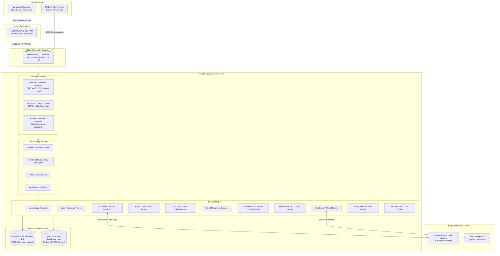

# 01. SYSTEM ARCHITECTURE & MODULAR MONOLITH DESIGN
## WAPPay Conversational Financial Platform — Phase 1 Technical Design

---

## 1. Architectural Philosophy & Style

The platform is designed as an enterprise **Modular Monolith** applying **Domain-Driven Design (DDD)** and **Clean Architecture** principles.

### Architectural Decision: Modular Monolith vs. Microservices
> **Decision:** We strictly avoid distributed microservices in early phases.
> **Justification:** Financial transactions require strict atomic consistency (ACID) and zero-drift recordkeeping. Introducing distributed networks (saga patterns, two-phase commits across network boundaries) creates failure modes where network partitions can lead to orphaned debits or credits. A modular monolith hosted within a single logical deployment allows database transactions (`BEGIN...COMMIT`) to provide atomic guarantees across customer reservations and ledger journals.
> **Future Extraction Boundary:** Modules maintain strict internal boundaries (no direct table cross-queries; communication occurs via explicit domain application service contracts or local events), allowing future extraction into dedicated microservices (e.g., AI Intent Service or Webhook Ingestion Service) without restructuring domain logic.

---

## 2. End-to-End System Architecture Diagram

---

## 3. Module Responsibilities & Boundary Matrix

| Module | Core Responsibility | Inbound Interfaces | Outbound Dependencies |
| :--- | :--- | :--- | :--- |
| **`AuthenticationModule`** | Admin JWT session management, TOTP MFA, customer transaction PIN hashing (Argon2id), 3-attempt lockout. | HTTP Admin Login, Internal Auth Guards | `PrismaService`, `RedisService` |
| **`CustomerModule`** | Customer lifecycle (`PENDING_VERIFICATION`, `ACTIVE`, `SUSPENDED`, `RESTRICTED`), KYC tiers, daily transaction limits. | `ConversationRouter`, Admin Controller | `PrismaService`, `AuditService` |
| **`RecipientModule`** | Saved destination accounts, alias mapping ("Mum" $\rightarrow$ NUBAN), duplicate alias disambiguation. | `ConversationRouter`, `TransactionsService` | `PrismaService`, `FinancialProviderModule` |
| **`ConversationalAIModule`** | Intent classification, entity/slot extraction, voice transcription routing. **Strict zero-execution boundary.** | `ConversationRouter`, `VoiceService` | `IAIProvider` contract |
| **`VoiceModule`** | WhatsApp audio media retrieval, format verification (16MB max), speech-to-text pipeline. | `WhatsAppWebhookController` | `AIService`, `ConversationRouter` |
| **`FinancialProviderModule`**| Formal adapter abstraction for external bank APIs (Paystack, Flutterwave, Monnify, Sandbox). | `TransactionsService`, `ReconciliationService` | `HttpService`, `ConfigService` |
| **`TransactionModule`** | Core orchestrator, 11-state deterministic state machine, distributed transaction locking, idempotency enforcement. | `ConversationRouter`, Admin Controller | `LedgerService`, `FinancialProviderModule`, `AuthService` |
| **`LedgerModule`** | Double-entry journal engine, minor-unit (Kobo) arithmetic, zero-sum invariant check, immutable postings. | `TransactionsService`, `ReconciliationService` | `PrismaService` (Atomic `$transaction`) |
| **`WebhooksModule`** | Transactional inbox deduplication, HMAC-SHA256 signature verification, fast 500ms acknowledgement. | HTTP Public Webhooks | `MessagingModule`, `TransactionsModule` |
| **`ReconciliationModule`** | Scheduled 3-way automated matching (Internal DB vs. Provider Statements vs. General Ledger). | BullMQ Cron Scheduler, Admin Controller | `LedgerService`, `FinancialProviderModule` |
| **`AuditModule`** | Append-only, immutable audit trail for administrative interventions, status changes, and security events. | Internal Domain Events | `PrismaService` |
| **`AdminModule`** | Operations oversight, transaction monitoring, customer restrictions. **Zero customer access.** | HTTP Admin Portal | All Core Domain Services |

---

## 4. Key Architectural Decisions & Fintech Rationales

### Decision 1: Customer Custody & Licensing Boundary
- **Context:** Does WAPPay hold customer deposits or operate as an independent mobile money operator (MMO)?
- **Decision:** The platform operates strictly under a **Partner-Bank / FinTech Licensee Sponsorship Model**. 
- **Rationale:** Under Central Bank of Nigeria (CBN) regulations, storing customer funds requires a Commercial Banking, Microfinance Banking, or Mobile Money Operator license. WAPPay does not hold legal custody of customer funds. Customer deposits reflect funds held in custodial escrow at the licensed partner bank. Internal ledger balances mirror the partner's verified accounts.

### Decision 2: AI Isolation & Zero-Execution Rule
- **Context:** Can the AI execute or trigger transfers directly when it is confident?
- **Decision:** The Conversational AI layer is strictly sandboxed and **read-only**. It emits structured proposals (`ParsedIntentProposal`) but has zero database or provider execution access.
- **Rationale:** LLMs are non-deterministic and susceptible to prompt injection, hallucination, and adversarial input. Financial authorization must remain deterministic, verified by backend application logic and explicit customer cryptographic PIN verification.
