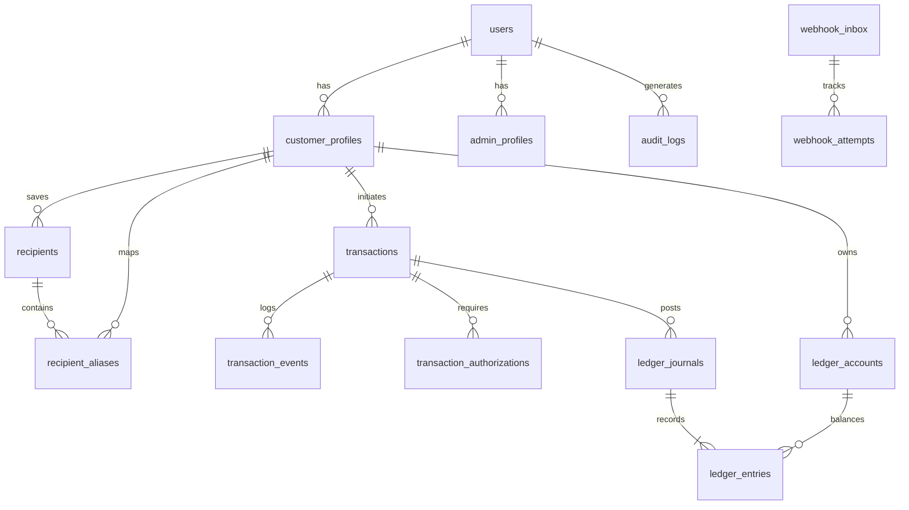

# 02. DATABASE SCHEMA & RELATIONAL DATA MODEL
## WAPPay Conversational Financial Platform — Phase 1 Technical Design

---

## 1. Database Principles & Financial Invariants

1. **Integer Minor Units (Kobo):** All monetary figures (`amountKobo`, `feeKobo`, `balanceKobo`, `dailyLimitKobo`) are stored as `BIGINT`. Storing amounts in Kobo ($1\text{ NGN} = 100\text{ Kobo}$) completely prevents IEEE 754 floating-point inaccuracies.
2. **Immutable Financial Tables:** Tables `ledger_journals`, `ledger_entries`, and `audit_logs` are append-only. Updates and deletions are strictly blocked at the application and database trigger levels.
3. **Auditability & Traceability:** Every state change in `transactions` generates an immutable record in `transaction_events`. Every administrative override creates an `audit_logs` record.
4. **Idempotency Uniqueness:** `idempotencyKey` has unique database indexes on both `transactions` and `ledger_journals` to enforce single execution at the storage engine level.

---

## 2. Entity-Relationship Diagram (ERD)

---

## 3. Detailed Table Specifications & Constraints

### 3.1 Identity & Access Control

#### `users`
- `id` (UUIDv7, PK): Globally unique user identifier.
- `phoneNumber` (VARCHAR(32), UNIQUE, INDEX): E.164 formatted phone number.
- `email` (VARCHAR(255), UNIQUE, NULLABLE): Administrative user email.
- `role` (ENUM: `ADMIN`, `CUSTOMER`): High-level system role.
- `isActive` (BOOLEAN, DEFAULT true): Master kill-switch for user activity.
- `createdAt` (TIMESTAMPTZ, DEFAULT now()): Registration timestamp.
- `updatedAt` (TIMESTAMPTZ, auto-updated).

#### `admin_profiles`
- `id` (UUIDv7, PK).
- `userId` (UUIDv7, FK `users.id`, UNIQUE, CASCADE DELETE).
- `adminRole` (ENUM: `SUPER_ADMIN`, `OPERATIONS_ADMIN`, `FINANCE_ADMIN`, `SUPPORT_ADMIN`, `AUDITOR`).
- `passwordHash` (TEXT): Argon2id password hash.
- `isMfaEnabled` (BOOLEAN, DEFAULT false): Mandatory TOTP flag.
- `mfaSecret` (TEXT, ENCRYPTED, NULLABLE): Base32 TOTP secret.
- `lastLoginAt` (TIMESTAMPTZ, NULLABLE).

#### `customer_profiles`
- `id` (UUIDv7, PK).
- `userId` (UUIDv7, FK `users.id`, UNIQUE, CASCADE DELETE).
- `fullName` (VARCHAR(255)): Verified customer full name.
- `whatsappNumber` (VARCHAR(32), UNIQUE, INDEX): Customer WhatsApp ID.
- `status` (ENUM: `PENDING_VERIFICATION`, `ACTIVE`, `SUSPENDED`, `RESTRICTED`, `CLOSED`).
- `kycTier` (ENUM: `TIER_1`, `TIER_2`, `TIER_3`).
- `pinHash` (TEXT, NULLABLE): Argon2id hash of 4-digit transaction PIN.
- `failedPinAttempts` (INT, DEFAULT 0): Counter for brute-force tracking.
- `pinLockedUntil` (TIMESTAMPTZ, NULLABLE): Temporary lockout expiration.
- `dailyLimitKobo` (BIGINT, DEFAULT 50000000): 24-hour transfer ceiling (500,000 NGN).
- `accountReference` (VARCHAR(64), UNIQUE, NULLABLE): Dedicated partner virtual account number.

---

### 3.2 Recipients & Aliases

#### `recipients`
- `id` (UUIDv7, PK).
- `customerId` (UUIDv7, FK `customer_profiles.id`, INDEX).
- `accountName` (VARCHAR(255)): Verified name from NIP name enquiry.
- `accountNumber` (VARCHAR(10)): 10-digit NUBAN.
- `bankCode` (VARCHAR(10)): CBN 3-digit or 6-digit institution code.
- `bankName` (VARCHAR(100)): Human-readable bank name.
- `isVerified` (BOOLEAN, DEFAULT false).
- **Constraints:** `UNIQUE(customerId, accountNumber, bankCode)` prevents duplicate saved accounts.

#### `recipient_aliases`
- `id` (UUIDv7, PK).
- `customerId` (UUIDv7, FK `customer_profiles.id`, INDEX).
- `recipientId` (UUIDv7, FK `recipients.id`, CASCADE DELETE).
- `alias` (VARCHAR(100)): Normalized lowercase alias (e.g., "mum", "john", "landlord").
- **Constraints:** `UNIQUE(customerId, alias)` prevents one alias mapping to multiple different accounts without explicit disambiguation.

---

### 3.3 Double-Entry Accounting Ledger

#### `ledger_accounts`
- `id` (UUIDv7, PK).
- `accountNumber` (VARCHAR(64), UNIQUE, INDEX): e.g., `11100`, `21000-CUST-UUID`.
- `name` (VARCHAR(255)): Human-readable account name.
- `type` (ENUM: `ASSET`, `LIABILITY`, `EQUITY`, `REVENUE`, `EXPENSE`).
- `currency` (VARCHAR(3), DEFAULT 'NGN').
- `balanceKobo` (BIGINT, DEFAULT 0): Materialized running balance in minor units.
- `isSystemAccount` (BOOLEAN, DEFAULT false): Flags immutable core accounts.
- `customerId` (UUIDv7, FK `customer_profiles.id`, NULLABLE, INDEX).

#### `ledger_journals`
- `id` (UUIDv7, PK).
- `reference` (VARCHAR(64), UNIQUE, INDEX): Unique journal reference (e.g., `JRN_RES_TXN_...`).
- `description` (TEXT): Audit explanation of the financial event.
- `status` (ENUM: `POSTED`, `REVERSED`).
- `idempotencyKey` (VARCHAR(128), UNIQUE, INDEX): Enforces single posting.
- `postedAt` (TIMESTAMPTZ, DEFAULT now()).
- `reversalReference` (VARCHAR(64), UNIQUE, NULLABLE): Points to original journal reference.
- `transactionId` (UUIDv7, FK `transactions.id`, NULLABLE, INDEX).

#### `ledger_entries`
- `id` (UUIDv7, PK).
- `journalId` (UUIDv7, FK `ledger_journals.id`, CASCADE DELETE, INDEX).
- `accountId` (UUIDv7, FK `ledger_accounts.id`, INDEX).
- `direction` (ENUM: `DEBIT`, `CREDIT`).
- `amountKobo` (BIGINT, CHECK `amountKobo > 0`): Positive minor units.
- `balanceAfterKobo` (BIGINT): Snapshot of account balance immediately after this entry.
- `createdAt` (TIMESTAMPTZ, DEFAULT now()).

---

### 3.4 Transactions & Authorizations

#### `transactions`
- `id` (UUIDv7, PK).
- `internalReference` (VARCHAR(64), UNIQUE, INDEX): e.g., `TXN_1793553515_440BD9`.
- `idempotencyKey` (VARCHAR(128), UNIQUE, INDEX).
- `customerId` (UUIDv7, FK `customer_profiles.id`, INDEX).
- `type` (ENUM: `TRANSFER`, `DEPOSIT`, `WITHDRAWAL`, `AIRTIME_PURCHASE`, `DATA_PURCHASE`, `PAYMENT`, `REFUND`, `REVERSAL`, `FEE`, `ADJUSTMENT`).
- `state` (ENUM: `CREATED`, `VALIDATING`, `AWAITING_AUTHORIZATION`, `AUTHORIZED`, `PROCESSING`, `SUCCESSFUL`, `FAILED`, `PENDING`, `REQUIRES_RECONCILIATION`, `REVERSED`, `CANCELLED`).
- `amountKobo` (BIGINT, CHECK `amountKobo > 0`).
- `feeKobo` (BIGINT, DEFAULT 0).
- `currency` (VARCHAR(3), DEFAULT 'NGN').
- `providerReference` (VARCHAR(128), UNIQUE, NULLABLE, INDEX): Partner bank reference.
- `destinationAccountNumber` (VARCHAR(10), NULLABLE).
- `destinationBankCode` (VARCHAR(10), NULLABLE).
- `destinationAccountName` (VARCHAR(255), NULLABLE).
- `recipientAlias` (VARCHAR(100), NULLABLE).
- `isSimulated` (BOOLEAN, DEFAULT true): Audit flag distinguishing test from live transfers.
- `failureReason` (TEXT, NULLABLE).
- `createdAt` (TIMESTAMPTZ, DEFAULT now(), INDEX).
- `updatedAt` (TIMESTAMPTZ, auto-updated).

#### `transaction_events`
- `id` (UUIDv7, PK).
- `transactionId` (UUIDv7, FK `transactions.id`, CASCADE DELETE, INDEX).
- `fromState` (VARCHAR(32)).
- `toState` (VARCHAR(32)).
- `reason` (TEXT, NULLABLE).
- `metadata` (JSONB, NULLABLE).
- `createdAt` (TIMESTAMPTZ, DEFAULT now()).

#### `transaction_authorizations`
- `id` (UUIDv7, PK).
- `transactionId` (UUIDv7, FK `transactions.id`, CASCADE DELETE, INDEX).
- `challengeToken` (VARCHAR(64), UNIQUE, INDEX): 5-minute single-use token.
- `expiresAt` (TIMESTAMPTZ, INDEX).
- `isUsed` (BOOLEAN, DEFAULT false).
- `authorizedAt` (TIMESTAMPTZ, NULLABLE).
- `failedAttempts` (INT, DEFAULT 0).

---

### 3.5 Infrastructure, Ingestion & Audit

#### `webhook_inbox`
- `id` (UUIDv7, PK).
- `provider` (VARCHAR(32)): e.g., 'meta', 'paystack', 'sandbox'.
- `eventType` (VARCHAR(64)).
- `eventId` (VARCHAR(128), UNIQUE, INDEX): Deduplication key.
- `payload` (TEXT): Raw payload for verification & reprocessing.
- `signature` (TEXT, NULLABLE).
- `status` (ENUM: `RECEIVED`, `PROCESSING`, `PROCESSED`, `FAILED`, `DEAD_LETTER`).
- `retryCount` (INT, DEFAULT 0).
- `lastError` (TEXT, NULLABLE).
- `receivedAt` (TIMESTAMPTZ, DEFAULT now()).
- `processedAt` (TIMESTAMPTZ, NULLABLE).

#### `audit_logs`
- `id` (UUIDv7, PK).
- `actorId` (UUIDv7, FK `users.id`, NULLABLE, INDEX).
- `actorType` (VARCHAR(32)): 'ADMIN', 'CUSTOMER', 'SYSTEM'.
- `action` (VARCHAR(64)): e.g., `CUSTOMER_STATUS_CHANGE`, `MANUAL_RECONCILIATION`.
- `resource` (VARCHAR(64)): e.g., `CustomerProfile`, `LedgerJournal`.
- `resourceId` (VARCHAR(64), NULLABLE).
- `beforeState` (JSONB, NULLABLE).
- `afterState` (JSONB, NULLABLE).
- `ipAddress` (VARCHAR(45), NULLABLE).
- `userAgent` (TEXT, NULLABLE).
- `reason` (TEXT, NULLABLE): Mandatory for administrative overrides.
- `createdAt` (TIMESTAMPTZ, DEFAULT now(), INDEX).
