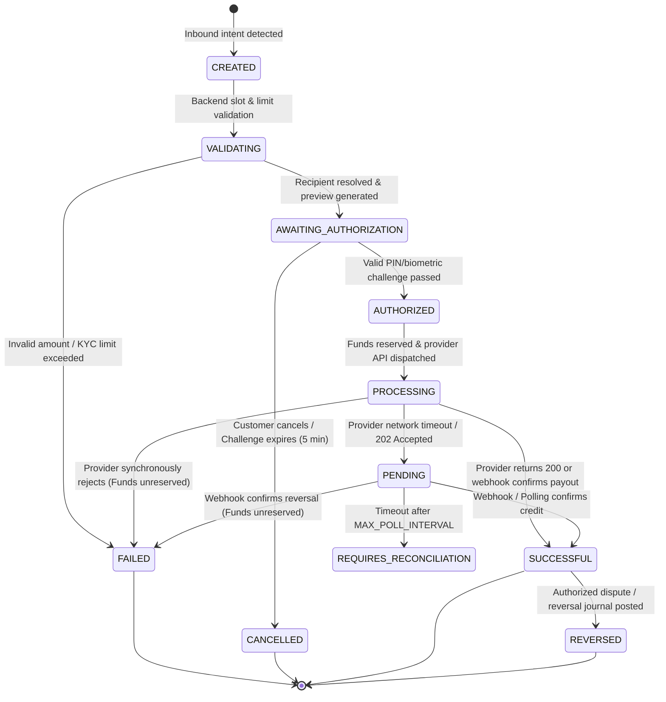

# 04. TRANSACTION LIFECYCLE, STATE MACHINE & AUTHORIZATION
## WAPPay Conversational Financial Platform — Phase 1 Technical Design

---

## 1. 11-State Finite State Machine (FSM)

---

## 2. Transition Matrix & Permitted Paths

| Source State | Permitted Destination States | Invariant Rationale |
| :--- | :--- | :--- |
| **`CREATED`** | `VALIDATING`, `FAILED`, `CANCELLED` | Initial transient state upon intent ingestion. |
| **`VALIDATING`** | `AWAITING_AUTHORIZATION`, `FAILED`, `CANCELLED` | Checks customer balance and daily KYC limits. |
| **`AWAITING_AUTHORIZATION`** | `AUTHORIZED`, `FAILED`, `CANCELLED` | Requires customer PIN challenge token verification. |
| **`AUTHORIZED`** | `PROCESSING`, `FAILED`, `CANCELLED` | Two-phase ledger reservation executed. |
| **`PROCESSING`** | `SUCCESSFUL`, `FAILED`, `PENDING` | API instruction submitted to provider. |
| **`PENDING`** | `SUCCESSFUL`, `FAILED`, `REQUIRES_RECONCILIATION` | Network uncertainty / asynchronous clearing rail. |
| **`REQUIRES_RECONCILIATION`** | `SUCCESSFUL`, `FAILED`, `REVERSED` | Unresolved outcome escalated to operations. |
| **`SUCCESSFUL`** | `REVERSED` | **Terminal.** Can only be reversed via dual-control audit. |
| **`FAILED`** | None (Terminal) | No transitions permitted. |
| **`CANCELLED`** | None (Terminal) | No transitions permitted. |
| **`REVERSED`** | None (Terminal) | No transitions permitted. |

---

## 3. The Network Timeout Invariant

> [!CAUTION]
> **Fintech Rule: Network Timeouts Are Never Failures**
> If a network timeout (`504 Gateway Timeout` or socket hangup) occurs when calling a financial partner's payout API, the transaction **must never** be marked as `FAILED`.
>
> **Reason:** The external partner bank may have already received, processed, and debited the funds to the destination account before the response connection was dropped. Marking the internal transaction as `FAILED` and refunding the customer would enable the customer to withdraw the refunded funds while the recipient keeps the payout—resulting in a double disbursement loss.
>
> **Mandatory Action:** The transaction enters `PENDING`. Funds remain locked in `Customer Reserved`. Background workers poll the provider status enquiry endpoint or await signed webhooks before finalizing the state.

---

## 4. Customer Authorization & Security Architecture

### 4.1 Phone Number Is Not Authorization
A WhatsApp message originating from a verified phone number is **never** treated as sufficient transaction authorization. WhatsApp accounts can be cloned, SIM cards swapped, or phones stolen.

### 4.2 Two-Step Challenge Flow
1. **Transaction Preview Generation:**
   Before any money moves, the customer is presented with an unambiguous summary:
   - Destination Account Name (verified from NIP name enquiry).
   - Destination Bank Name & NUBAN.
   - Transfer Amount.
   - Platform Fee.
   - Total Debit Amount.
   - Challenge token with 5-minute time-to-live (`TTL = 300s`).
2. **Cryptographic PIN Verification:**
   - The customer enters their 4-digit PIN.
   - Verification is computed using **Argon2id** (`memoryCost: 64MB, timeCost: 3, parallelism: 4`).
   - Plaintext PINs are never persisted in the database or written to logs.
3. **Brute-Force Rate Limiting & Lockout:**
   - A customer profile tracks `failedPinAttempts`.
   - 3 consecutive incorrect PIN submissions result in an immediate **30-minute lockout** (`pinLockedUntil = now + 30m`).
   - All subsequent financial attempts during the lockout window are immediately rejected with HTTP 403 Forbidden.
   - An alert is logged to `audit_logs` for suspicious activity monitoring.
