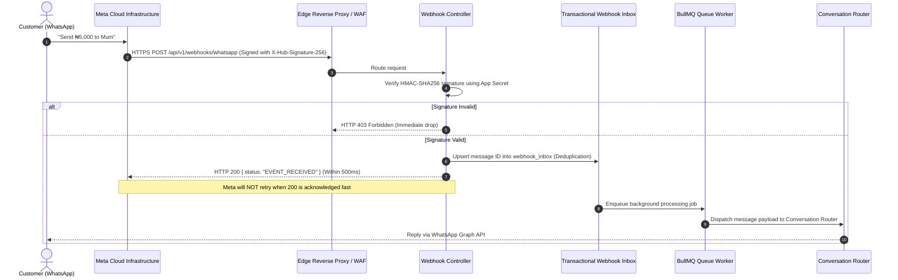

# 06. WHATSAPP CLOUD API INTEGRATION ARCHITECTURE
## WAPPay Conversational Financial Platform — Phase 1 Technical Design

---

## 1. Meta WhatsApp Cloud API Architecture

---

## 2. Inbound Webhook Verification Handshake
Meta requires a one-time verification handshake when registering webhook URLs in the Meta Developer Portal:

- **Endpoint:** `GET /api/v1/webhooks/whatsapp`
- **Query Parameters:**
  - `hub.mode`: Must equal `'subscribe'`.
  - `hub.verify_token`: Must match configured `WHATSAPP_WEBHOOK_VERIFY_TOKEN`.
  - `hub.challenge`: Random challenge integer sent by Meta.
- **Response:** The server returns `hub.challenge` as plain text with HTTP 200.

---

## 3. Cryptographic Signature Verification
Meta calculates an HMAC-SHA256 hash across the raw request body using the Meta App Secret. Every incoming POST request includes:
`X-Hub-Signature-256: sha256=<hex_digest>`

### Verification Implementation:
1. Capture raw, unparsed request buffer before body-parser serialization.
2. Compute `crypto.createHmac('sha256', appSecret).update(rawBuffer).digest('hex')`.
3. Use `crypto.timingSafeEqual` to prevent timing-attack side-channel vulnerabilities.

---

## 4. Transactional Inbox & Deduplication
WhatsApp / Meta webhooks follow **at-least-once delivery semantics**. If an acknowledgement takes longer than 20 seconds, Meta automatically retries sending the same message.

To prevent duplicate transfers:
1. Every message includes a unique Meta message ID (`wamid.HBg...`).
2. The `webhook_inbox` table enforces `UNIQUE(eventId)`.
3. If an incoming message ID already exists:
   - It is acknowledged immediately with HTTP 200.
   - Processing is skipped, preventing duplicate processing by the conversational engine.
