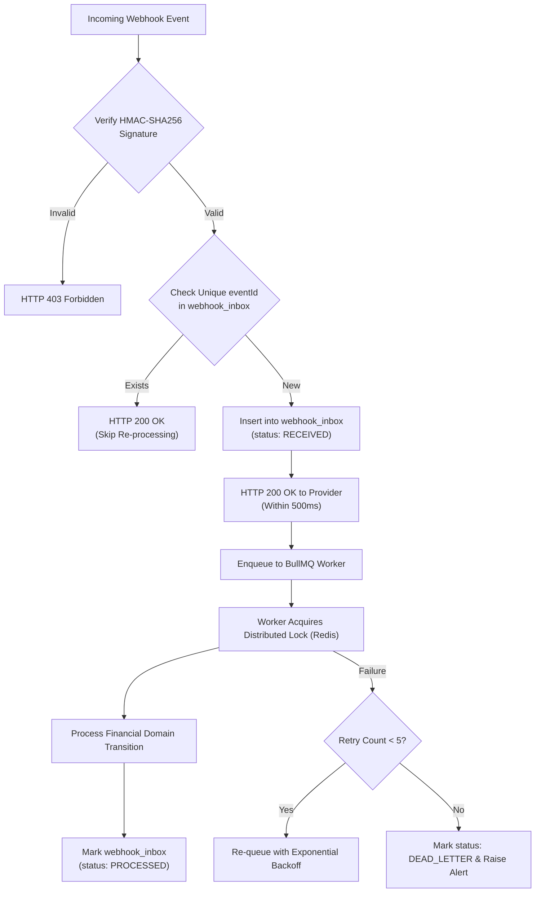

# 10. WEBHOOK PROCESSING & IDEMPOTENCY STRATEGY
## WAPPay Conversational Financial Platform — Phase 1 Technical Design

---

## 1. Webhooks as Untrusted External Input

Financial provider and Meta WhatsApp webhooks originate from external networks and must be treated as untrusted input.
They present critical failure modes:
1. **Network Retries / Duplication:** Providers retry events upon receiving timeouts, resulting in the same payload arriving multiple times.
2. **Out-of-Order Delivery:** A `TRANSFER_SUCCESSFUL` webhook may arrive before the initial `TRANSFER_INITIATED` response.
3. **Replay Attacks:** Adversaries intercepting webhook payloads attempting to re-submit them.

---

## 2. Ingestion & Idempotency Pipeline



---

## 3. Distributed Idempotency Key Architecture

Idempotency is enforced across three distinct layers:
1. **Client / WhatsApp Channel:** Every conversational transfer intent is assigned an internal idempotency key: `WA_{customerId}_{timestamp}`.
2. **Provider Dispatch Rail:** When calling external bank payout APIs, the internal transaction UUID (`idempotencyKey`) is supplied in the provider's `Idempotency-Key` or `reference` header.
3. **Database Constraint:**
   ```sql
   CREATE UNIQUE INDEX idx_transactions_idempotency_key ON transactions(idempotency_key);
   CREATE UNIQUE INDEX idx_ledger_journals_idempotency_key ON ledger_journals(idempotency_key);
   CREATE UNIQUE INDEX idx_webhook_inbox_event_id ON webhook_inbox(event_id);
   ```
   If a race condition occurs, PostgreSQL's unique constraint immediately rejects the second transaction with a uniqueness violation error (`23505`), preventing duplicate debits or credits.

---

## 4. Dead-Letter Queues (DLQ) & Operator Recovery
If an incoming event fails processing repeatedly (e.g. database network disruption or malformed payload):
- After 5 exponential backoff retries ($10\text{s}, 30\text{s}, 90\text{s}, 300\text{s}, 900\text{s}$), the inbox entry status is set to `DEAD_LETTER`.
- An incident alert is posted to `audit_logs` and operational telemetry.
- Operators can inspect the full raw payload in `webhook_inbox.payload` and trigger a controlled replay after resolving the underlying issue.
