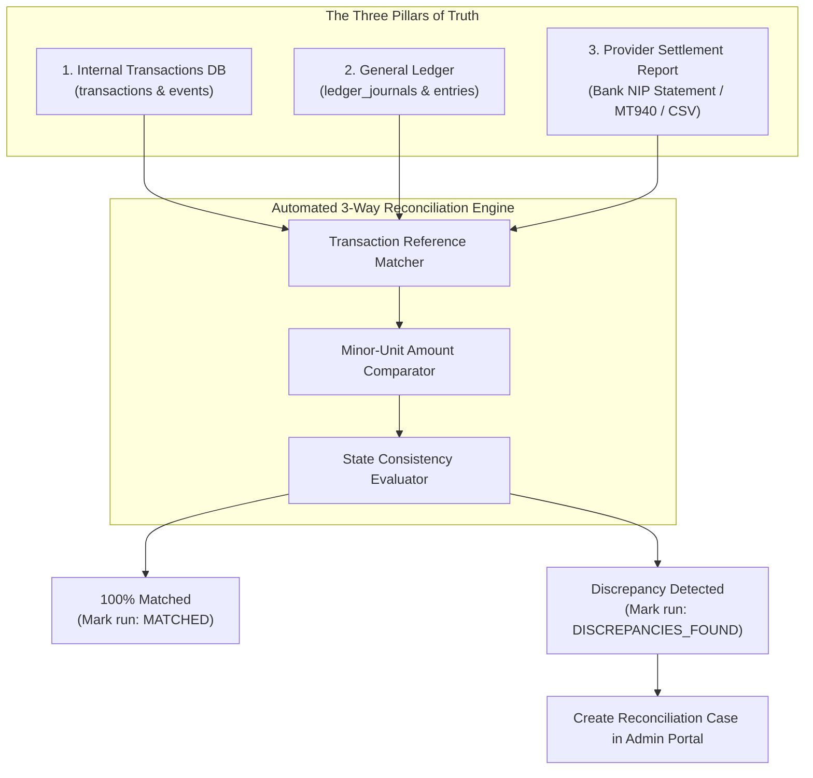

# 11. FINANCIAL RECONCILIATION & DISPUTE ARCHITECTURE
## WAPPay Conversational Financial Platform — Phase 1 Technical Design

---

## 1. Why Reconciliation Is Non-Negotiable

In fintech applications, an API response indicating HTTP 200 does **not** guarantee that settlement occurred correctly across downstream bank switches:
- External bank switches may reverse a payout hours after initial success due to network clearing errors.
- Uncaptured interchange fees may cause account balances to drift from actual partner escrow balances.
- Database crashes midway through execution may leave transactions in limbo.

Reconciliation is the automated process that mathematically verifies internal records against external reality.

---

## 2. Three-Way Reconciliation Architecture

---

## 3. Discrepancy Classifications

| Discrepancy Type | Description | Root Cause / Risk |
| :--- | :--- | :--- |
| **`MISSING_LEDGER_POSTING`** | Transaction marked `SUCCESSFUL` in database but lacks an associated balanced journal entry. | Severe internal drift. Database rollback occurred after status update. |
| **`AMOUNT_MISMATCH`** | Amount debited from customer does not match the settled payout amount on the provider report. | Currency precision error or undocumented provider fee deduction. |
| **`STATUS_MISMATCH`** | Internal state is `PENDING`, but provider report shows `SUCCESSFUL` or `FAILED`. | Dropped webhook callback. |
| **`ORPHAN_PROVIDER_PAYOUT`** | Provider report contains a payout reference not found in the internal database. | Potential unauthorized administrative payout or security breach. |
| **`UNRESOLVED_PENDING_TIMEOUT`**| Transaction has remained in `PENDING` state for $> 30$ minutes without terminal confirmation. | Stalled in bank clearing network. Requires manual NIP status enquiry. |

---

## 4. The Zero-Silent-Correction Invariant

> [!CAUTION]
> **Fintech Rule: Never Silently Edit Balances to Force Reconciliations**
> - Software must **never** automatically run an update like:
>   `UPDATE ledger_accounts SET balance = provider_balance` to eliminate a discrepancy.
> - Every discrepancy must remain visible on the administrative dashboard until investigated.
> - Correcting an identified variance requires posting a **compensatory journal entry** (`REVERSAL` or `ADJUSTMENT`) referencing the reconciliation run ID, authored by a `FINANCE_ADMIN` and approved by a `SUPER_ADMIN`.
