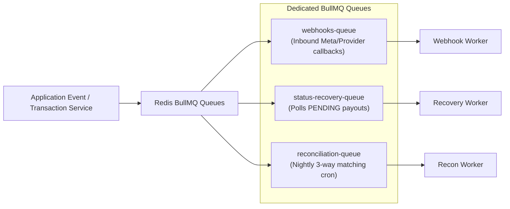

# 12. ERROR HANDLING, RECOVERY & BACKGROUND JOBS
## WAPPay Conversational Financial Platform — Phase 1 Technical Design

---

## 1. Resilience Philosophy: Designing for Failure

Financial systems must be engineered on the assumption that external partner APIs, networks, and background workers will fail frequently.
We classify failures into two categories:
1. **Deterministic Failures:** Invalid PIN, insufficient customer balance, invalid account number. $\rightarrow$ Handled immediately with synchronous domain exceptions.
2. **Transient & Indeterminate Failures:** Network timeouts, HTTP 500/504 errors from partner banks, worker crashes midway through execution. $\rightarrow$ Handled via asynchronous recovery jobs and stateful polling.

---

## 2. Background Job Architecture (BullMQ + Redis)

---

## 3. Transaction Status Recovery Worker

For any transaction that enters the `PENDING` state due to a provider timeout:
1. **Scheduled Polling Interval:** The `status-recovery-queue` schedules a job with exponential backoff: 30s, 2m, 5m, 15m, 30m.
2. **Provider Status Query:** The worker calls `provider.getTransactionStatus(providerReference)`.
3. **Outcomes:**
   - **`SUCCESS`:** The worker commits the settlement journal (`Customer Reserved` $\rightarrow$ `Provider Clearing` + `Fee Revenue`), transitions the state to `SUCCESSFUL`, and notifies the customer via WhatsApp.
   - **`FAILED`:** The worker rolls back the reserved funds back to the customer's available balance (`Customer Reserved` $\rightarrow$ `Customer Deposits`), marks the state as `FAILED`, and notifies the customer.
   - **Still `PENDING` after 30 minutes:** Escalate transaction to `REQUIRES_RECONCILIATION` and raise an alert on the administrator dashboard.

---

## 4. Failure Mode Recovery Matrix

| System Component Failure | Immediate Impact | Automatic Recovery Mechanism |
| :--- | :--- | :--- |
| **Provider Network Timeout (504)** | Payout status unknown. | Transaction transitions to `PENDING`. Funds stay reserved. Recovery worker polls provider status enquiry. |
| **Redis Outage** | Cache and distributed lock degradation. | Application degrades to direct database queries and pessimistic SQL row-level locks (`SELECT ... FOR UPDATE`). |
| **Worker Process Crash** | Job halted midway. | BullMQ lock renewal expires. Another worker claims the stalled job and resumes idempotently using database transaction checks. |
| **Database Network Blip** | Transaction rollback. | Global exception filter catches error, logs correlation ID, and returns HTTP 500 without leaking connection credentials. |
