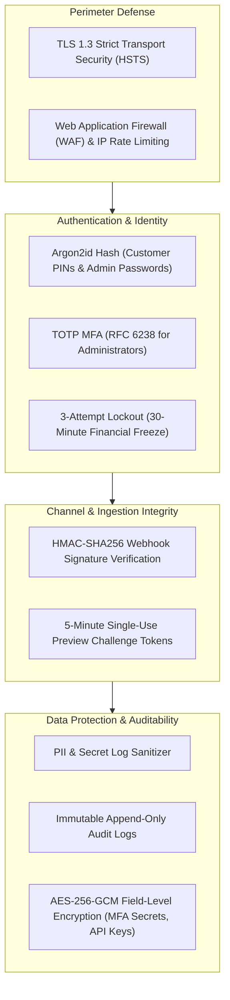

# 13. SECURITY ARCHITECTURE & THREAT MODEL (STRIDE)
## WAPPay Conversational Financial Platform — Phase 1 Technical Design

---

## 1. Security Defense-in-Depth Architecture

---

## 2. Formal STRIDE Threat Model & Mitigations

| STRIDE Category | Threat Scenario | Impact | Mitigation Strategy |
| :--- | :--- | :--- | :--- |
| **Spoofing** | Attacker sends forged HTTP POST to `/webhooks/whatsapp` claiming customer sent a transfer instruction. | Unauthorized payout execution. | Verify `X-Hub-Signature-256` HMAC using Meta App Secret. Reject payloads with missing or invalid signatures with HTTP 403. |
| **Tampering** | Man-in-the-middle or malicious client alters destination account number after PIN preview is displayed. | Payout diverted to attacker account. | The authorization token is bound to a cryptographic hash of the exact transfer preview parameters (amount, recipient, fee). Any parameter mismatch invalidates the token. |
| **Repudiation** | Customer claims they never authorized a ₦50,000 transfer to a recipient. | Financial dispute & chargeback risk. | Append-only audit logs capture: Meta message ID, timestamp, verified customer PIN challenge event, and IP address. |
| **Information Disclosure** | Customer Bank Verification Number (BVN), full account numbers, or internal DB error logs exposed in HTTP responses. | Regulatory non-compliance (NDPR) & identity theft. | `GlobalExceptionFilter` intercepts all exceptions. Stack traces and database errors are scrubbed. Responses return standardized RFC 7807 codes. |
| **Denial of Service** | Botnet floods webhook endpoint with validly formatted requests to exhaust database connections. | Platform unavailability. | Redis token-bucket rate limiter throttles traffic per IP address and phone number before reaching database connections. |
| **Elevation of Privilege** | Support admin crafts a direct HTTP request to execute an unauthorized balance adjustment. | Fraudulent ledger modification. | Service-layer `@Roles()` guards enforce RBAC. Balance adjustments strictly require `SUPER_ADMIN` dual approval. |

---

## 3. Cryptographic Standards

1. **Argon2id for Password & PIN Storage:**
   - Memory Cost: $65,536\text{ KB}$ ($64\text{ MB}$)
   - Time Cost: $3\text{ iterations}$
   - Parallelism: $4\text{ threads}$
   - Resilient against GPU-accelerated and ASIC brute-force attacks.
2. **AES-256-GCM for Secrets at Rest:**
   - Provider API keys and administrator TOTP secrets are encrypted using authenticated AES-256-GCM before persistence.
3. **Log Sanitization:**
   - Interceptors automatically redact: `password`, `pin`, `token`, `secret`, `bvn`, and account numbers (showing only the last 4 digits).
