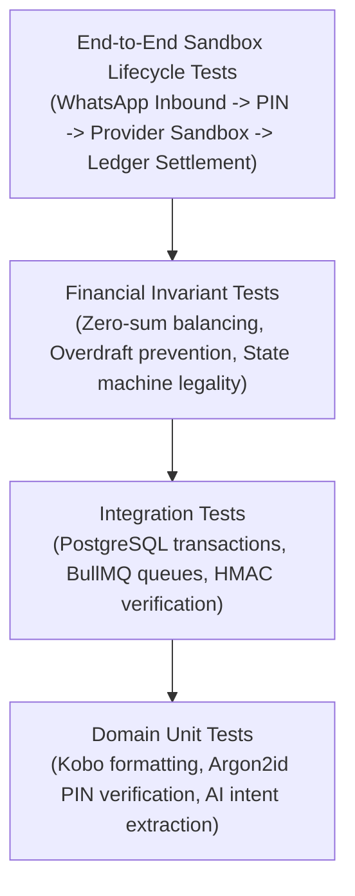

# 15. AUTOMATED TESTING STRATEGY & INVARIANT PROOFS
## WAPPay Conversational Financial Platform — Phase 1 Technical Design

---

## 1. Banking-Grade Testing Standard

In conventional software engineering, unit tests verify that functions execute without exceptions.
In financial engineering, automated tests must mathematically prove **invariants**:
- That money cannot be created or destroyed from nothing.
- That transactions cannot be processed twice.
- That balances cannot dip below zero.
- That network drops cannot cause duplicate disbursements.

---

## 2. Test Pyramid & Coverage Requirements

### Coverage Goals:
- **Ledger & Transaction Engine:** 100% statement, branch, and invariant coverage.
- **Security & Authorization Guards:** 100% path coverage.
- **Provider Adapters & Webhook Parsers:** 95%+ coverage including edge failure cases (dropped packets, invalid signatures, malformed payloads).

---

## 3. The 10 Essential Financial Invariant Tests

1. **Zero-Sum Mathematical Invariant:** $\sum \text{Debits} \equiv \sum \text{Credits}$ across all journals.
2. **Positive Minor Units:** Rejects journals containing zero or negative amounts.
3. **Overdraft Guard:** Rejects debits that would cause customer deposit liabilities to dip below zero.
4. **Idempotency Replay Safety:** Repeating a transfer with the same idempotency key returns the original result without duplicate balance mutations.
5. **State Machine Strictness:** Illegal direct jumps (e.g. `CREATED` $\rightarrow$ `SUCCESSFUL`) throw `InvalidStateTransitionException`.
6. **Network Timeout Guard:** Network timeouts transition transactions to `PENDING`, keeping funds safely reserved.
7. **Argon2id Brute-Force Lockout:** 3 incorrect PIN submissions lock customer transaction capabilities for 30 minutes.
8. **Preview Challenge Expiration:** Challenge tokens expire after 5 minutes; replayed tokens throw HTTP 403.
9. **HMAC Signature Rejection:** Webhooks with missing, invalid, or tampered signatures are dropped with HTTP 403.
10. **Compensating Reversals:** Adjustments do not delete historical journals; they post balanced compensating reversal journals referencing the original transaction.
