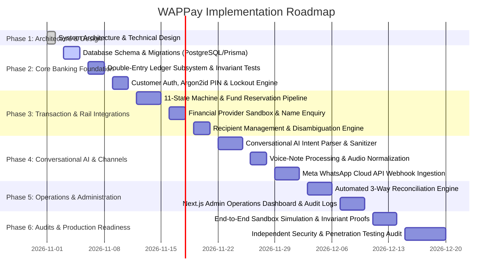

# 16. PHASED IMPLEMENTATION ROADMAP & RISK ANALYSIS
## WAPPay Conversational Financial Platform — Phase 1 Technical Design

---

## 1. Phased Implementation Roadmap

---

## 2. Identified Missing Requirements & Business Decisions

Before beginning live integration, the following non-technical business decisions must be resolved:

### 1. Legal Custody & Safeguarding Arrangement
- **Question:** Which licensed institution (e.g. Providus Bank, Wema Bank, Sterling Bank) will hold customer funds?
- **Impact on Architecture:** Determines whether the platform issues individual dedicated virtual accounts (NUBANs) tied to customer BVNs, or pooled omnibus virtual accounts.

### 2. Tiered KYC & Daily Transaction Limits
- **Question:** What are the exact transaction caps for Tier-1 (Phone number only) vs. Tier-2 (BVN/NIN verified) vs. Tier-3 (Address verified)?
- **Impact on Architecture:** In the current design, default daily limits are set to ₦500,000 for Tier-1; specific partner compliance mandates may require lower thresholds (e.g. ₦50,000).

### 3. Interchange Fee Structure
- **Question:** Are transfer fees fixed (e.g. ₦10 flat) or tiered based on transaction volume (e.g. ₦10 below ₦5,000; ₦25 between ₦5,001–₦50,000; ₦50 above ₦50,000)?
- **Impact on Architecture:** Fee calculation services must load tiered fee schedules dynamically from database configuration.

### 4. Dispute & Chargeback Windows
- **Question:** What is the legal dispute settlement window for fraudulent WhatsApp SIM swaps (e.g. 72 hours vs 14 days)?
- **Impact on Architecture:** Governs the retention duration of reserved funds in suspense accounts before final platform settlement.

---

## 3. Regulatory & Operational Risk Analysis

| Risk Category | Specific Exposure | Architectural Mitigation |
| :--- | :--- | :--- |
| **Regulatory (CBN)** | Operating an unlicensed stored-value wallet in Nigeria. | All funds are routed through the licensed partner bank. Internal ledgers mirror custodial escrow accounts. |
| **Data Protection (NDPR)** | Customer financial history leaked via WhatsApp or web logs. | End-to-end TLS 1.3, PII redaction interceptors, and Argon2id memory-hard hashing. |
| **Fraud (SIM Swap)** | Fraudster gains access to victim's WhatsApp account and transfers funds. | A WhatsApp message alone cannot move money; a separate 4-digit transaction PIN with 3-attempt lockout is required. |
| **Operational Drift** | Database balances diverge from external bank balances due to network blips. | Continuous automated 3-way reconciliation alerts operators to any ledger variance. |
